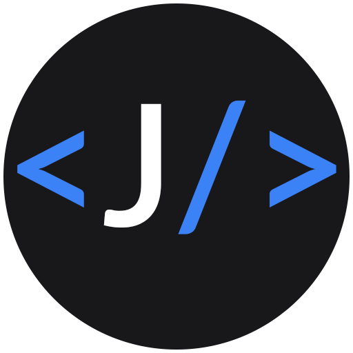
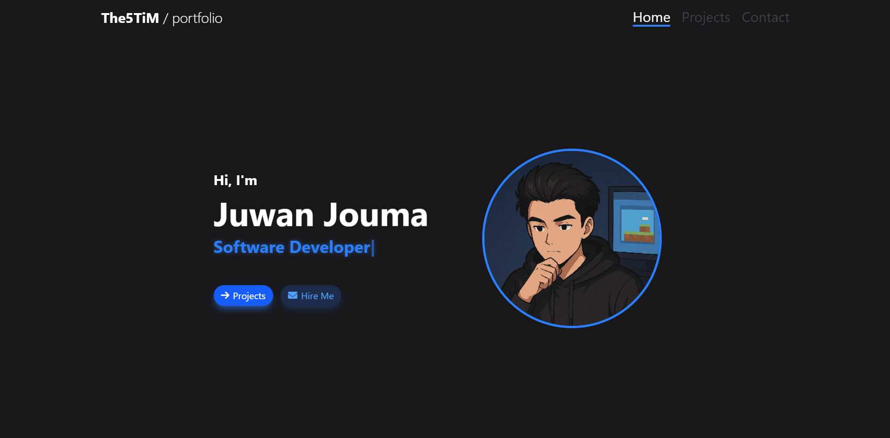
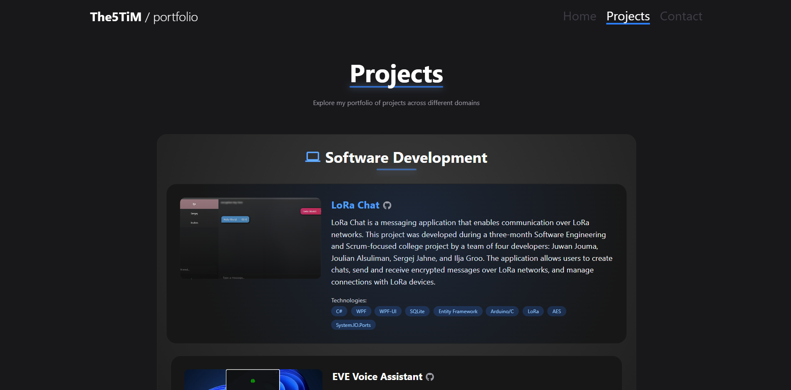
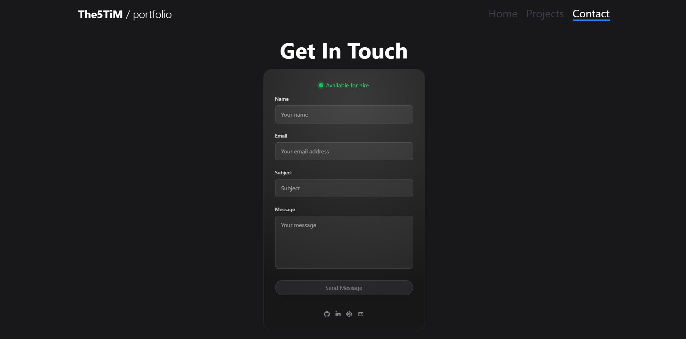
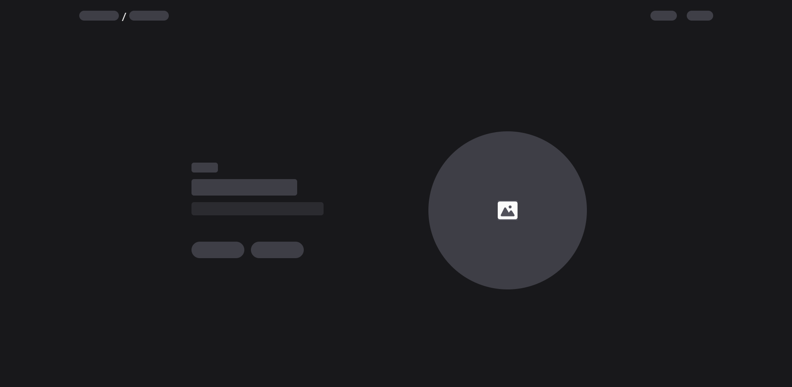

# Portfolio

<p align="center">
  
</p>

<p align="center">
  
  
  
  
  
  
  
  
  
</p>

## About

This is my personal portfolio website showcasing my skills, projects, and experience as a Software Developer, Game Developer, and Web Developer. The portfolio features a modern, responsive design with smooth animations and interactive elements.

## Features

- Responsive design for all devices
- Interactive UI with animations and transitions
- Skills showcase with categorization
- Project gallery with detailed descriptions
- Certification showcase
- Contact form with email integration

## Technologies

- **Vite**: Next-generation frontend tooling
- **React**: Frontend library for building user interfaces
- **TypeScript**: Typed JavaScript for better code quality
- **Reactbits**: UI components for React
- **Tailwind CSS**: Utility-first CSS framework
- **GSAP (Reactbits)**: Professional-grade animation library
- **Framer Motion (Reactbits)**: Animation library for React
- **React Router**: Navigation for single page applications
- **EmailJS**: Client-side email sending

## Project Structure

- **components/**: Reusable UI components
- **data/**: Data files for projects, skills, and personal information
- **pages/**: Main application pages
- **styles/**: Global styles and theme configuration
- **shared/**: Shared utilities and functions
- **public/**: Static assets like images and certificates

## Getting Started

### Prerequisites

- Node.js (v18 or higher)
- npm or yarn

### Environment Variables

<div align="center">
  
</div>

> **❗ Security Note**  
> Storing API keys in frontend code (even in environment variables) is not secure as they can be exposed to users.  
> **🔒 Move sensitive operations to a backend service**

<div align="center" style="margin: 2rem 0;">
  <em>⚠️ The current implementation is for demonstration purposes only.</em>
</div>

The following environment variables are required in your `.env` file:

```
# EmailJS Configuration
VITE_EMAILJS_PUBLIC_KEY=your_public_key_here
VITE_EMAILJS_SERVICE_ID=your_service_id_here
VITE_EMAILJS_TEMPLATE_ID=your_template_id_here
```

### Installation

1. Clone the repository
   ```bash
   git clone https://github.com/The5TiM/portfolio.git
   cd portfolio
   ```

2. Install dependencies
   ```bash
   npm install
   # or
   yarn
   ```

3. Start the development server
   ```bash
   npm run dev
   # or
   yarn dev
   ```

4. Open your browser and navigate to `http://localhost:5173`

### Building for Production

```bash
npm run build
# or
yarn build
```

## See It In Action

<p align="center">
  
  <br>
  <em>Home Page - Skills and expertise showcase</em>
</p>

<p align="center">
  
  <br>
  <em>Projects Page - Showcase of my work</em>
</p>

<p align="center">
  
  <br>
  <em>Contact Page - Get in touch</em>
</p>

<p align="center">
  
  <br>
  <em>Skeleton Loading - Smooth loading experience</em>
</p>

## License

Feel free to explore this codebase for educational purposes and inspiration for your own projects. You can learn from the implementation of various features and component structure.

However, **please do not copy this work and present it as your own**. I do not appreciate plagiarism of my personal work. If you find this portfolio being used without proper attribution, please contact me via email.

## Contact

If you have any questions or would like to get in touch, please reach out via email:

<p align="center">
  <a href="mailto:juwan.jouma@gmail.com"></a>
</p>

## Author

<p align="center">
  <a href="https://github.com/The5TiM"></a>
</p>